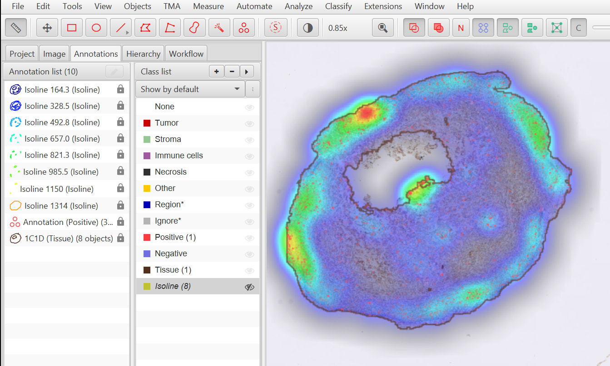
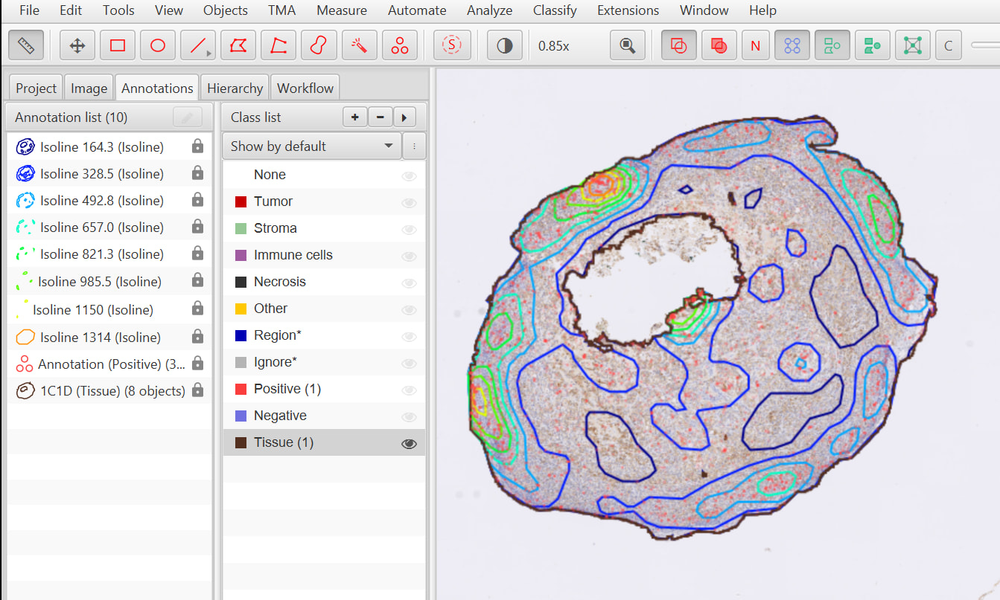

# QuPath Isolines Extension

Generate colour-coded vector **isoline** annotations from a QuPath density map,
as an alternative to displaying it as a dense raster/colour heatmap overlay.

## Background

Density maps in QuPath are great — especially with a punchy colormap — but a
dense colour overlay makes it difficult (impossible, really) to read the
image underneath it at the same time:



So instead of displaying a dense heatmap, this extension extracts **isolines**
from the density map and adds them to the hierarchy as "Isoline" annotations —
contour lines at chosen density levels, rather than a filled, opaque overlay:



Each level becomes its own `PathClass` named `Isoline <value>`, and each is
built by calling QuPath's own `DensityMaps.threshold(...)` once per level with
a distinct class. Because the resulting thresholded regions are nested
(region(≥v1) ⊃ region(≥v2) for v1 < v2), the *boundary* of each region is
exactly the isoline at that level. With annotation fill switched off in the
viewer, that gives contour lines rather than filled bands, coloured to match
whatever the raster heatmap preview would have looked like — so the
underlying image (e.g. an H-DAB stain) stays legible underneath.

This deliberately doesn't implement its own contour tracer — it just calls
QuPath's existing `DensityMaps.threshold` machinery once per level.

### Status

This is an experiment, built with a fair amount of help from Claude. It's
genuinely useful for spotting hotspots without losing the underlying image,
but I'm honestly not sure yet whether it's a keeper, and I'm not planning to
turn this into a QuPath core PR — partly because I haven't used it enough to
be confident it's the right approach, and partly because it's AI-assisted
code that I haven't fully reasoned through myself line by line. Sharing it
here in case it's useful to anyone else, or as a starting point if someone
wants to take the idea further.

Comments welcome.

## Building the extension

Standard QuPath extension build — you'll need a JDK matching whatever
QuPath version you're targeting (check `build.gradle` for the exact version
if in doubt).

```bash
git clone https://github.com/<your-username>/qupath-extension-isolines.git
cd qupath-extension-isolines
./gradlew build
```

(On Windows, use `gradlew.bat build` instead.)

This produces a jar under `build/libs/`. To install it into QuPath:

1. Open QuPath.
2. **Extensions → Installed extensions**, then click the button to open the
   extensions directory (or find it yourself — typically somewhere under
   your user's `QuPath/extensions` folder).
3. Copy the built jar into that folder.
4. Restart QuPath. The extension should appear under **Extensions**, with a
   menu item to open the Isolines dialog (enable it first from the
   Extensions preferences if it doesn't show up).

## Using the extension

You'll need a density map already built and saved as a JSON file — either via
QuPath's own **Analyze → Density maps → Load density map** dialog, or from a
density map builder script. By default the "Browse…" button in this
extension's dialog looks under your project's
`classifiers/density_maps` folder.

### Dialog options

| Option | What it does |
|---|---|
| **Heatmap** | Path to the density map JSON to generate isolines from. |
| **Channel** | Which channel/band of the density map to threshold. Only shown when the loaded map actually has more than one channel — e.g. a `PERCENT`-type map built from multiple criteria, where each criterion gets its own channel. An ordinary single-criterion Gaussian density map has only one channel, so this row is hidden entirely and channel 0 is used automatically — nothing to decide, nothing shown. When it *is* shown, the combo box lists each channel by name (not just a raw index), so it's clear what you're selecting. |
| **Levels** | Number of evenly-spaced isoline levels to generate, across the density map's own display range (as saved in its JSON — the same range/colormap the raster preview would have used). Endpoints are excluded, since a contour exactly at the map's min or max value usually isn't interesting. |
| **Clear existing isolines** | Removes any annotations already classified as an isoline (class name starting `Isoline `) before generating new ones. This matches by *prefix*, not exact class name, since every level gets its own distinct class (e.g. `Isoline 5.000`) — a previous run with different levels wouldn't otherwise be cleared. |
| **Mask isolines outside selected class** | Restricts isoline generation to annotations of a chosen classification (e.g. a tissue region) instead of running across the whole image. The dropdown is populated from classifications currently present among the image's own (non-point) annotations. |
| **Simplify contours** | If checked, each isoline's geometry is run through a topology-preserving simplifier immediately after it's created, at the given tolerance (in pixels, default 40). Raw pixel-boundary tracing can be jagged, especially at small radii — this smooths it out. It only simplifies boundaries; it doesn't remove small isolated islands or holes (see below). |
| **Generate isolines** | Runs isoline creation directly against the currently open image, using whatever's set in the dialog. |
| **Generate code** | Fills in a Groovy script template with the same settings and opens it as a new, unsaved script — handy for batch-processing a whole project, or for tweaking settings by hand afterwards. |

### The generated script

"Generate code" produces something like this (paths/values will match
whatever was set in the dialog):

```groovy
// This script was generated by the Isolines extension's dialog ('Generate code').
// It reproduces, as a re-runnable script, what the dialog's 'Generate isolines' button
// would do directly -- useful for batch-processing a project, or for tweaking the
// settings below by hand.

import qupath.ext.isolines.Isolines

// --- Settings chosen in the Isolines dialog ---

def densityMapPath = java.nio.file.Paths.get(
    "/some_path/densitymap.json")

def channel = 0
def nLevels = 8
def simplifyTolerance = 40.0

def imageData = getCurrentImageData()
def hierarchy = imageData.getHierarchy()

// (clear-existing / mask blocks appear here if those options were checked)

Isolines.createIsolinesFromJson(imageData, densityMapPath, channel, nLevels, maskObjects, simplifyTolerance)

// --- Optional further cleanup: remove small islands / holes ---
// Simplification (above) only smooths jagged boundaries -- it doesn't drop small isolated
// fragments or holes. Uncomment the block below to remove anything smaller than the given
// area (in pixels^2) via GeometryTools.refineAreas, if you're seeing a lot of those.
/*
hierarchy.getAnnotationObjects().findAll {
    it.getPathClass() != null && it.getPathClass().toString().startsWith("Isoline ")
}.each { isoline ->
    def isolineROI = isoline.getROI()
    def plane = isolineROI.getImagePlane()
    def geometry = GeometryTools.refineAreas(isolineROI.getGeometry(), 200, 200)
    isoline.setROI(GeometryTools.geometryToROI(geometry, plane))
}
*/
```

The commented-out block at the end is deliberately left as manual, opt-in
cleanup rather than another dialog checkbox: it solves a different problem
(dropping small fragments/holes by area) than the "Simplify contours" option
(smoothing boundary jaggedness), the right area thresholds vary a lot by
image, and it's a rarer need — so it's there to uncomment and tune by hand
if a particular density map produces a lot of small artefact regions.

## License

This project is licensed under the MIT License - see the [LICENSE](LICENSE) file for details. 

**Transparency Notice regarding AI Generation:**
This extension was conceptually architected by a human and relies on QuPath's core APIs, but the boilerplate syntax and specific script implementations were heavily assisted by generative AI (Claude). Because AI-generated code currently resides in a legal grey area regarding human authorship, the MIT license applied here strictly covers the human arrangement, architectural choices, and integration. The code is provided strictly "AS IS" with absolutely no warranties.